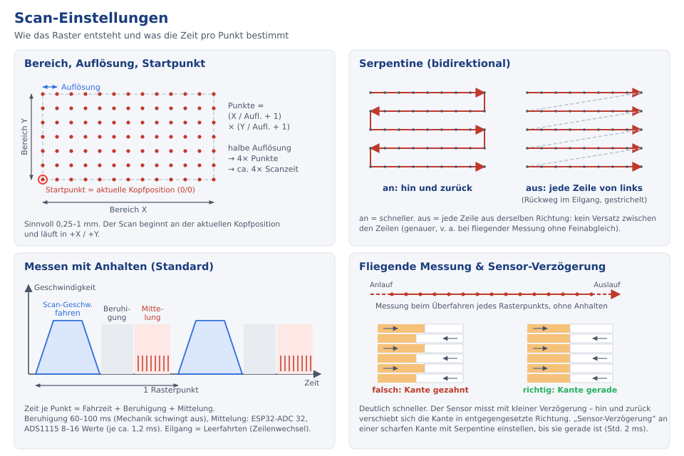
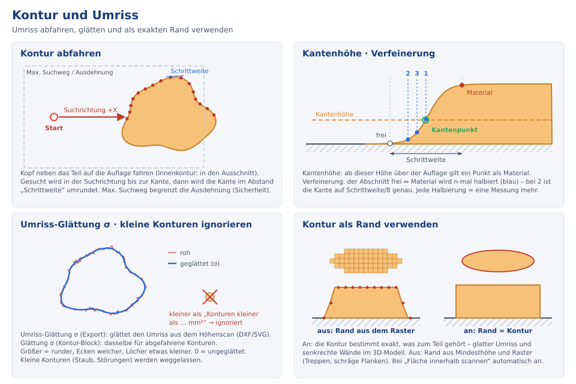
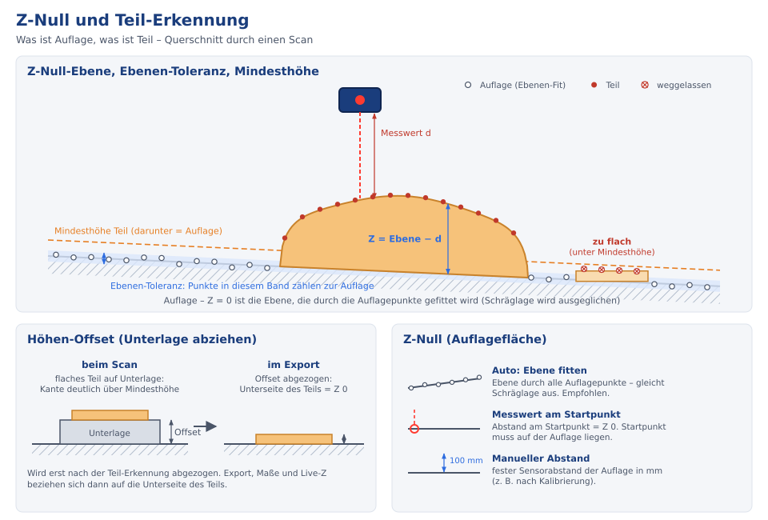
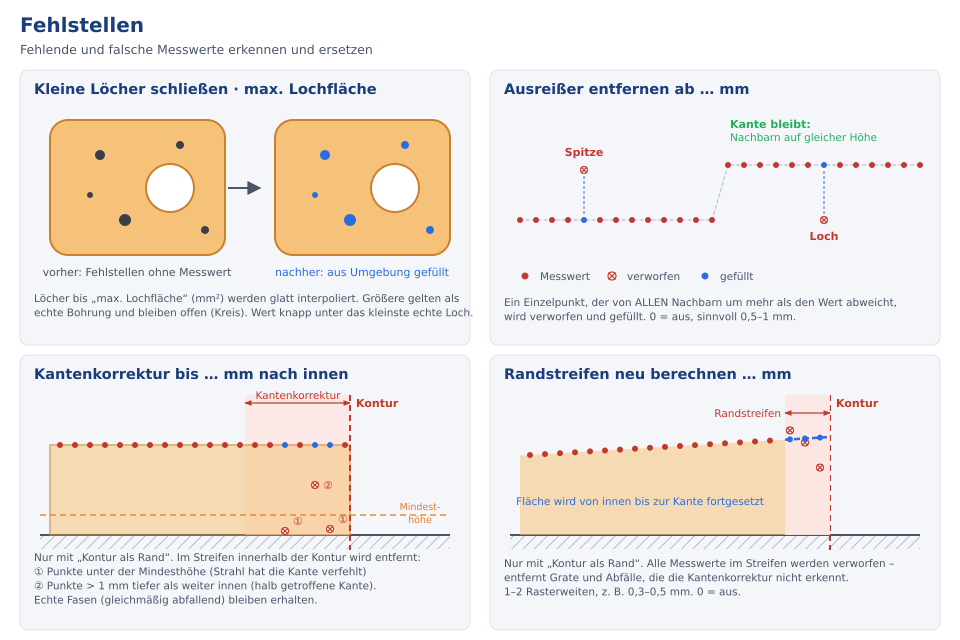
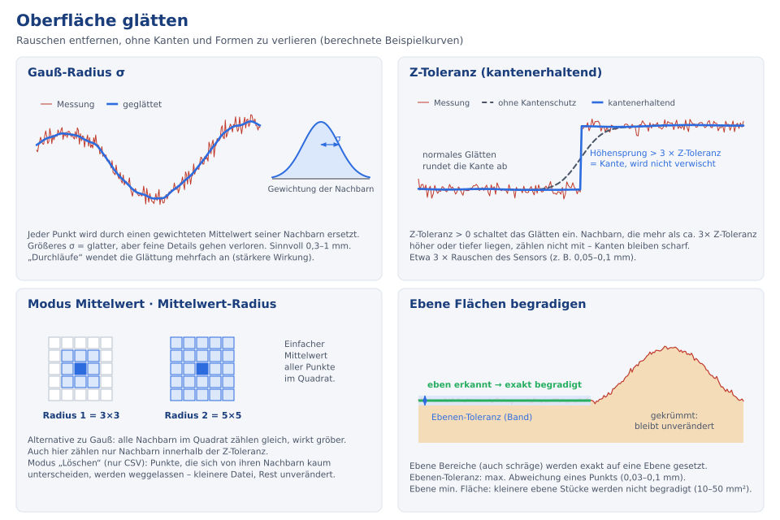
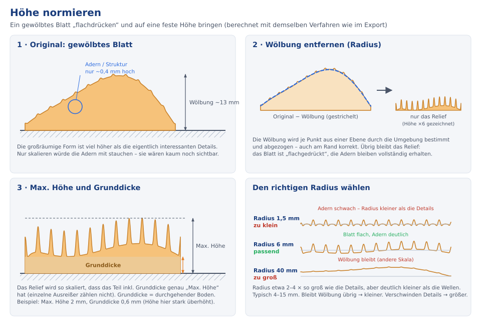
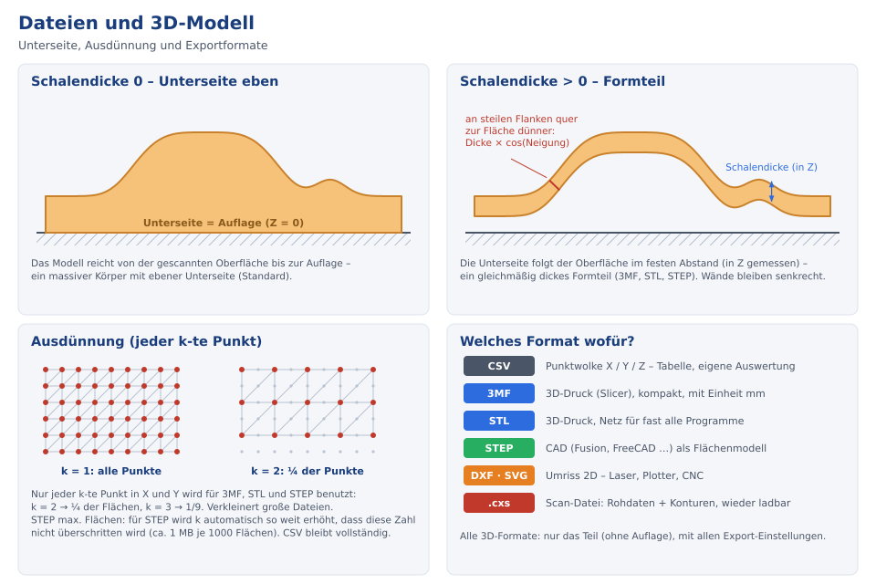

# Überblick

Der Scanner tastet eine Oberfläche mit einem Laser-Abstandssensor **Panasonic HG-C1100** rasterförmig ab und erzeugt daraus ein 3D-Modell. Der Sensor sitzt auf einem **CoreXY-Portal** mit zwei Closed-Loop-Schrittmotoren (GT2-Riemen, 20-Zahn-Pulleys). Gesteuert wird alles von einem **ESP32 Dev Module**, bedient über eine Weboberfläche im Browser.

**Funktionen**

- Scanbereich X × Y ab der aktuellen Position, Rasterweite frei wählbar
- zwei Messarten: *Anhalten an jedem Punkt* (höchste Genauigkeit) oder *fliegende Messung* (schnell)
- Scan pausieren und fortsetzen
- **Kontur abfahren:** nur den Umriss eines Teils (plus Innenausschnitte) ertasten, ohne Flächenscan – Ergebnis als geschlossene, geglättete Linie in DXF/SVG
- **Kontur + Höhenscan kombinieren:** nur die Fläche innerhalb der Kontur scannen; 3MF/STL/STEP bekommen senkrechte, scharfe Kanten exakt entlang der Kontur
- „Rahmen abfahren“ zur Kontrolle, ob das Teil vollständig im Scanbereich liegt
- Live-Vorschau als Höhenbild, Fortschritt mit Start-/Endzeit (NTP) und Restzeit
- Scandaten im Flash – bleiben bei Neustart, Stromausfall und Update erhalten; abgebrochene Scans werden als Teilscan übernommen
- Export als **CSV**, **3MF**, **STL** und **STEP**; die Auflagefläche (Z = 0) wird automatisch erkannt und weggelassen
- 16-Bit-Wandler ADS1115 mit Zwei-Punkt-Höhenkalibrierung
- Firmware-Update (OTA) über die Weboberfläche
- automatische Motor-Abschaltung nach 1 min ohne Bewegung

# Hardware

## Komponenten

| Komponente | Typ / Wert |
|---|---|
| Controller | **ESP32-S3** N16R8 (16 MB Flash, 8 MB PSRAM) oder **ESP32 Dev Module** (ESP32-D0WD-V3, WROOM, 4 MB Flash) – Umschaltung automatisch |
| Motoren | 2 × Closed-Loop-Schrittmotor, 200 Vollschritte/U, Mikroschritt 1–64 (eingestellt: 16) |
| Antrieb | GT2-Riemen (2 mm), Pulley 20 Zähne → 40 mm/U → **80 Schritte/mm** bei 16 Mikroschritten |
| Sensor | Panasonic HG-C1100, Messbereich 100 ± 35 mm, Analogausgang 4–20 mA bzw. 0–5 V |
| A/D-Wandler | ADS1115, 16 Bit, I²C (alternativ interner ESP32-ADC) |
| Shunt | 100 Ω, 0,1 %, ≤ 25 ppm/K (ohne ADS1115: ESP32-S3 100–120 Ω, klassischer ESP32 120 Ω) |

## Pinbelegung

Welche Belegung gilt, ergibt sich automatisch aus dem in der Arduino IDE gewählten Board (siehe `config.h`, Abschnitt Board-Auswahl).

| Signal | ESP32-S3 | ESP32 Dev Module | Aderfarbe |
|---|---|---|---|
| Motor A – STEP | 11 | 16 | Grün |
| Motor A – DIR | 10 | 4 | Gelb |
| Motor A – EN | 12 | 17 | Blau |
| Motor B – STEP | 17 | 19 | Grün |
| Motor B – DIR | 16 | 18 | Gelb |
| Motor B – EN | 18 | 21 | Blau |
| ADS1115 – SDA | 13 | 22 | |
| ADS1115 – SCL | 14 | 23 | |
| Sensor analog (nur ohne ADS1115) | 4 | 34 | Grau |

Hinweise ESP32-S3:

- Analogeingänge nur an **ADC1 (GPIO 1–10)**. ADC2 (GPIO 11–20) wird vom WLAN mitbenutzt, Messungen können ausfallen.
- Nicht verwenden: GPIO 19/20 (USB), 26–32 (Flash), 33–37 (PSRAM bei Octal-Modulen wie N16R8); Strapping-Pins 0, 3, 45, 46 meiden.

Hinweise klassischer ESP32:

- GPIO 6–11 sind mit dem Flash verbunden und dürfen nicht verwendet werden (führt zu Watchdog-Reset).
- GPIO 16/17 sind nur bei WROOM-Modulen frei; bei WROVER-Modulen belegt sie der PSRAM.

Allgemein:

- STEP-Pins müssen unter GPIO 32 liegen (schneller Registerzugriff in der Step-Routine).
- Closed-Loop-Treiber erwarten oft 5-V-Signale. Schalten die Eingänge mit 3,3 V nicht zuverlässig, einen Pegelwandler (z. B. 74AHCT125 an 5 V) dazwischen setzen.
- Der Enable-Eingang vieler Treiber schaltet den Motor bei aktivem Signal **ab**. Der Pegel ist in `config.h` über `EN_LEVEL_ACTIVE` einstellbar.

## Stromversorgung des ESP32

Laut Espressif schließen sich die Versorgung über USB und über den 5V-Pin gegenseitig aus. Wird beides gleichzeitig angeschlossen, kann das Netzteil in den USB-Port des PCs zurückspeisen.

- **Empfohlen:** Schottky-Diode (z. B. 1N5819 oder SS34) in die 5V-Zuleitung, Anode am Netzteil, Kathode am 5V-Pin. Am Board liegen dann ca. 4,7 V; USB kann jederzeit zusätzlich gesteckt werden.
- Alternativen: Updates nur per OTA, zum USB-Flashen das Netzteil abziehen oder ein USB-Kabel ohne 5V-Leitung verwenden.
- Die Masse von PC, Netzteil und ESP32 ist dabei verbunden – das ist richtig so.

## Sensor-Anschluss mit ADS1115 (empfohlen)

```
                       +12…24 V ── HG-C1100 (+V)
                                  HG-C1100 (0 V) ───────────────┬── GND Netzteil
                                                                │
HG-C1100 Analogausgang (4–20 mA) ──┬──[ 1 kΩ ]──┬── AIN0        │
                                   │            │   ADS1115     │
                              R_shunt 100 Ω   100 nF            │
                              0,1 %, ≤25 ppm    │               │
                                   │            │               │
GND ───────────────────────────────┴────────────┴── AIN1 / GND ─┴── GND ESP32

ADS1115:  VDD → 3,3 V (ESP32)    GND  → GND
          SDA → GPIO 13 (S3) / 22  SCL → GPIO 14 (S3) / 23
          ADDR → GND (Adresse 0x48)
```

| Teil | Wert | Zweck |
|---|---|---|
| Shunt | 100 Ω, 0,1 % | 4–20 mA → 0,4–2,0 V, passt in den ±2,048-V-Bereich |
| Messbereich ADS | ±2,048 V | 62,5 µV pro Stufe → ca. 0,003 mm Auflösung |
| RC-Filter | 1 kΩ + 100 nF | Störspitzen unterdrücken, Grenzfrequenz ca. 1,6 kHz |
| Messung | differenziell AIN0 – AIN1 | Masseversatz fällt heraus; AIN1 direkt am Shunt-Fußpunkt |

**Wichtig:** Den ADS1115 nur mit **3,3 V** versorgen. Übliche Platinen ziehen SDA/SCL auf ihre Versorgungsspannung; mit 5 V lägen 5 V an den ESP32-Pins. Sensor-0V, Netzteil-GND und ESP32-GND müssen verbunden sein.

**Variante 0–5 V:** Spannungsteiler 15 kΩ (oben) / 10 kΩ (unten) → 2,0 V bei 5 V, dazu dasselbe RC-Filter. Störanfälliger als der Stromausgang.

## Sensor-Anschluss ohne ADS1115

Der Analogausgang wird über einen Shunt nach GND direkt an den Analogeingang des ESP32 geführt. In `config.h` dafür `SENSOR_ADC_ADS1115` auf `0` setzen und `SHUNT_OHM` auf den tatsächlichen (gemessenen) Wert.

| | ESP32-S3 | ESP32 Dev Module |
|---|---|---|
| Eingang | GPIO 4 (ADC1_CH3) | GPIO 34 (ADC1_CH6) |
| Linear bis ca. | 2,9 V | 2,45 V |
| Shunt 4–20 mA | 100 Ω (0,4–2,0 V) oder 120 Ω (0,48–2,4 V) | 120 Ω (0,48–2,4 V) |
| Teiler 0–5 V | 22 kΩ / 24 kΩ → 2,6 V | 22 kΩ / 20 kΩ → 2,38 V |
| Auflösung (voller Messbereich) | ca. 0,02–0,03 mm pro Stufe | ca. 0,02–0,03 mm pro Stufe |

Ist der ADS1115 geplant, gleich den 100-Ω-Shunt verwenden – dann ist später kein Umbau nötig.

# Software

## Dateien

| Datei | Inhalt |
|---|---|
| `CoreXY_Scanner.ino` | Hauptprogramm: WLAN, Webserver, Scanablauf, Speicher, OTA, NTP |
| `config.h` | Pins, Mechanik, Bewegung, Sensor, Wandler |
| `secrets.h` | WLAN-Zugangsdaten, Netzwerk |
| `motion.h / .cpp` | CoreXY-Bewegung per Timer-Interrupt |
| `sensor.h / .cpp` | Sensor-Auswertung (ADS1115 oder ESP32-ADC), Kalibrierung |
| `webpage.h` | Weboberfläche inkl. Export (CSV/3MF/STL/STEP) |
| `partitions.csv` | eigene Partitionstabelle, je Board eine Version (siehe Arduino-IDE-Einstellungen) |

Alle Dateien liegen im Sketch-Ordner `CoreXY_Scanner`. Externe Bibliotheken werden nicht benötigt.

## Arduino-IDE-Einstellungen

Board-Paket: **Arduino-ESP32 (Espressif) ab Version 3.0**. Externe Bibliotheken werden nicht benötigt. Pins und Shunt werden automatisch passend zum gewählten Board eingestellt.

### ESP32-S3 N16R8

| Einstellung | Wert |
|---|---|
| Board | **ESP32S3 Dev Module** |
| USB CDC On Boot | **Enabled** am Anschluss „USB“, **Disabled** am Anschluss „COM“/„UART“ |
| CPU Frequency | 240MHz (WiFi) |
| Core Debug Level | None |
| USB DFU On Boot | Disabled |
| Erase All Flash Before Sketch Upload | beim **ersten** Upload Enabled, danach **Disabled** |
| Events Run On / Arduino Runs On | Core 1 / Core 1 |
| Flash Mode | QIO 80MHz |
| Flash Size | **16MB (128Mb)** |
| JTAG Adapter | Disabled |
| USB Firmware MSC On Boot | Disabled |
| Partition Scheme | wird durch `partitions.csv` ersetzt (ohne Datei: **8M with spiffs (3MB APP/1.5MB SPIFFS)**) |
| PSRAM | **OPI PSRAM** |
| Upload Mode | UART0 / Hardware CDC |
| Upload Speed | 921600 |
| USB Mode | Hardware CDC and JTAG |

**Partitionstabelle (`partitions.csv` für 16 MB):** 2 × 3 MB Programm (OTA) und 9,9 MB Scan-Speicher (ca. 4,9 Mio. Punkte; die Firmware begrenzt auf `MAX_POINTS` = 2 Mio.).

| Name | Typ | SubType | Offset | Größe |
|---|---|---|---|---|
| nvs | data | nvs | 0x9000 | 0x5000 |
| otadata | data | ota | 0xE000 | 0x2000 |
| app0 | app | ota_0 | 0x10000 | 0x300000 |
| app1 | app | ota_1 | 0x310000 | 0x300000 |
| spiffs | data | spiffs | 0x610000 | 0x9E0000 |
| coredump | data | coredump | 0xFF0000 | 0x10000 |

Keine „16M Flash … FATFS“-Schemas wählen – der Scan-Speicher braucht eine SPIFFS-Partition. Klappt der erste Upload nicht: BOOT halten, RESET kurz drücken, BOOT loslassen.

### ESP32 Dev Module (klassisch)

| Einstellung | Wert |
|---|---|
| Board | **ESP32 Dev Module** |
| CPU Frequency | 240MHz (WiFi/BT) |
| Flash Mode / Frequency | QIO / 80MHz |
| Flash Size | **4MB (32Mb)** |
| Partition Scheme | **Default 4MB with spiffs (1.2MB APP/1.5MB SPIFFS)** |
| PSRAM | Disabled |
| Upload Speed | 921600 |
| Erase All Flash Before Sketch Upload | beim ersten Upload Enabled, danach Disabled |

Mit dem Default-Schema stehen ca. 1,3 MB für Scandaten zur Verfügung (ca. 640 000 Punkte). Passt der Sketch nicht in 1,25 MB, die 4-MB-`partitions.csv` verwenden: 2 × 1,44 MB Programm und 1 MB Scan-Speicher (ca. 480 000 Punkte).

| Name | Typ | SubType | Offset | Größe |
|---|---|---|---|---|
| nvs | data | nvs | 0x9000 | 0x5000 |
| otadata | data | ota | 0xE000 | 0x2000 |
| app0 | app | ota_0 | 0x10000 | 0x170000 |
| app1 | app | ota_1 | 0x180000 | 0x170000 |
| spiffs | data | spiffs | 0x2F0000 | 0x100000 |
| coredump | data | coredump | 0x3F0000 | 0x10000 |

### Gemeinsam für beide

- Die IDE verwendet immer die Datei mit dem Namen `partitions.csv` im Sketch-Ordner und ignoriert dann das Menü „Partition Scheme“. Beim Boardwechsel die passende Datei hineinlegen (beide Versionen außerhalb des Sketch-Ordners aufbewahren).
- **Nach einem Board- oder Partitionswechsel einmal per USB flashen** – ein OTA-Update überträgt die Partitionstabelle nicht. Gespeicherter Scan und Höhen-Kalibrierung gehen dabei verloren.
- Kontrolle im seriellen Monitor (115200 Baud): `LittleFS: … kB gesamt` – S3 mit 16-MB-Tabelle ca. 10 100 kB, klassischer ESP32 ca. 1 300 kB (bzw. ca. 950 kB mit eigener Tabelle).

## secrets.h

| Eintrag | Bedeutung |
|---|---|
| `WIFI_SSID`, `WIFI_PASS` | WLAN-Zugangsdaten (nur 2,4 GHz) |
| `USE_STATIC_IP` | `0` = DHCP mit Reservierung im Router (empfohlen), `1` = feste IP im ESP32 |
| `LOCAL_IP`, `GATEWAY_IP`, `SUBNET_MASK`, `DNS_IP` | nur bei fester IP, mit Kommas statt Punkten |
| `HOSTNAME` | Gerätename im Netzwerk |

## config.h – wichtige Parameter

| Parameter | Standard | Bedeutung |
|---|---|---|
| `BOARD_ESP32S3` / `BOARD_ESP32` | automatisch | Board-Auswahl; nur zum Erzwingen eine Zeile aktivieren |
| `MICROSTEPS` | 16 | muss zur DIP-Einstellung der Treiber passen |
| `DIR_INVERT_A/B` | false | Drehrichtung der Motoren (siehe Inbetriebnahme) |
| `EN_LEVEL_ACTIVE` | LOW | Pegel für „Motor bestromt“ |
| `ACCEL_MM_S2` | 300 | Beschleunigung; 1000–2000 meist möglich, bestimmt die Scanzeit bei kleinem Raster |
| `IDLE_DISABLE_MS` | 60000 | Motoren aus nach dieser Zeit ohne Bewegung |
| `TICK_HZ` | 40000 | Takt der Step-Routine, max. Stepfrequenz = halber Takt |
| `SENSOR_ADC_ADS1115` | 1 | 1 = ADS1115, 0 = interner ADC |
| `SENSOR_MODE_CURRENT` | 1 | 1 = 4–20 mA, 0 = 0–5 V |
| `SHUNT_OHM` | 100 | Shunt-Widerstand |
| `DIST_AT_MIN_MM` / `DIST_AT_MAX_MM` | 135 / 65 | Abstand bei 4 mA bzw. 20 mA (bei Skalierung des Sensorausgangs anpassen) |
| `NTP_SERVER1/2`, `TZ_INFO` | fritz.box, pool.ntp.org, MEZ/MESZ | Zeitquelle und Zeitzone |

# Inbetriebnahme

1. **Netzwerk:** Nach dem Flashen zeigt der serielle Monitor (115200 Baud) die **MAC-Adresse**. Damit im Router eine feste IP reservieren. Bei Verbindungsproblemen gibt der Monitor den Trennungsgrund aus (z. B. Grund 15/204 = falsches Passwort, 201 = SSID nicht gefunden).
2. **Weboberfläche** im Browser öffnen: `http://<IP-Adresse>/`.
3. **Fahrrichtungen prüfen** mit den Jog-Tasten:

| Fehlerbild | Abhilfe in `config.h` |
|---|---|
| X und Y vertauscht | einen der beiden `DIR_INVERT` umschalten |
| beide Achsen falsch herum | beide `DIR_INVERT` umschalten |
| nur Y falsch herum | Pins von Motor A und B tauschen |

4. **Sensorrichtung prüfen:** Ein Objekt näher an den Sensor halten – der angezeigte Abstand muss kleiner werden. Sonst `DIST_AT_MIN_MM` und `DIST_AT_MAX_MM` tauschen.
5. **ADS1115 prüfen:** Unter „Wandler / Kal.“ muss *ADS1115* stehen. Wird er nicht gefunden, meldet der serielle Monitor `ADS1115 nicht gefunden`.
6. **Höhen-Kalibrierung** durchführen (siehe unten).
7. **Rauschen ermitteln:** Kopf über die Auflage stellen und den Live-Abstand ca. 30 s beobachten. Die Schwankung ist das Rauschen; danach richten sich die Toleranzen im Export.

## Höhen-Kalibrierung (2 Punkte)

Im Bereich *Manuell verfahren*:

1. Kopf über eine freie Stelle der Auflage fahren → **„1: Auflage messen“**.
2. Endmaß bekannter Höhe (ideal 20–50 mm) darunterlegen, Höhe eintragen → **„2: Endmaß messen“**.
3. Gemessene und Soll-Höhe sowie der neue Faktor werden angezeigt → **„Übernehmen“**.

Die Werte werden dauerhaft im ESP32 gespeichert (auch über OTA). „Zurücksetzen“ stellt Faktor 1 / Offset 0 wieder her. Unplausible Werte (Faktor außerhalb 0,8–1,25) werden abgelehnt.

# Bedienung

## Aufbau der Weboberfläche

| Bereich | Inhalt |
|---|---|
| Kopfleiste (immer sichtbar) | Zustand, X/Y/Z-Position, **PAUSE/WEITER**, **STOP** |
| Zeile 1 | Status · Scan-Einstellungen · Export-Einstellungen |
| Zeile 2 | Manuell verfahren (inkl. Kalibrierung) · Firmware-Update |
| Zeile 3 | Vorschau |

Die Einstellungsbereiche lassen sich per Klick auf die Überschrift einklappen; der Zustand wird im Browser gespeichert. Unter 900 px Breite werden alle Bereiche untereinander angezeigt.

Z in der Kopfleiste ist die Live-Höhe über der Auflage. Sie richtet sich nach der Z-Null-Einstellung im Export; „Auto“ und „Startpunkt“ benötigen einen vorhandenen Scan.

## Manuell verfahren

Die Pfeiltasten X+/X−/Y+/Y− haben zwei Funktionen:

- **kurz tippen:** ein Schritt der eingestellten Schrittweite
- **gedrückt halten** (länger als 0,25 s): der Kopf fährt mit der eingestellten Geschwindigkeit, bis die Taste losgelassen wird, und bremst dann sanft ab

Sicherheit: Während der Dauerfahrt sendet der Browser alle 0,2 s ein Lebenszeichen. Bleibt es länger als 0,6 s aus (Taste losgelassen, WLAN-Aussetzer, Browser geschlossen), bremst der ESP32 selbst ab. Pro Druck fährt er höchstens 500 mm (`JOG_MAX_MM`, `JOG_KEEPALIVE_MS` in `config.h`). Es gibt keine Endschalter – rechtzeitig loslassen.

## Ablauf eines Scans

1. Kopf mit den Jog-Tasten auf die **linke vordere Ecke** des Scanbereichs fahren.
2. Bereich X/Y und Auflösung eintragen.
3. **„Rahmen abfahren“** – der Kopf fährt den Bereich einmal als Rechteck ab und endet wieder am Startpunkt. Am Lichtpunkt des Sensors ist zu erkennen, ob das Teil vollständig im Rahmen liegt.
4. **„Scan starten“** – die aktuelle Position wird zum Nullpunkt. Nach dem Scan fährt der Kopf zum Startpunkt zurück.
5. Nach Abschluss in den Export-Einstellungen die gewünschten Dateien erzeugen.

**PAUSE** hält den Scan an einer sicheren Stelle an: beim Anhalten-Modus nach dem aktuellen Punkt, bei fliegender Messung am Ende der aktuellen Zeile. Die Motoren bleiben bestromt, die Position bleibt erhalten. **WEITER** setzt den Scan fort. Pausenzeiten werden bei Laufzeit und Restzeit nicht mitgezählt; Jog-Fahrten sind während der Pause gesperrt.

**STOP** bricht den Scan ab (auch aus der Pause). Bereits gescannte Zeilen werden als fertiger Teilscan übernommen („DONE (abgebrochen)“) und können exportiert werden.

## Scan-Einstellungen

| Feld | Bedeutung |
|---|---|
| Bereich X / Y | Größe des Scanbereichs ab aktueller Position in mm |
| Auflösung XY | Rasterweite in mm |
| Scan-Geschw. | Geschwindigkeit zwischen den Punkten bzw. Zeilengeschwindigkeit (fliegend) |
| Eilgang | Geschwindigkeit für Positionierfahrten |
| Beruhigung | Wartezeit nach dem Anfahren eines Punkts (nur Anhalten) |
| Mittelung | Anzahl Messwerte pro Punkt (nur Anhalten; ADS1115: 8–16, je ca. 1,2 ms) |
| Serpentine | Zeilen abwechselnd hin und zurück (schneller); aus = jede Zeile aus derselben Richtung (genauer) |
| Fliegende Messung | Zeile ohne Anhalten durchfahren, Messung beim Überfahren jedes Rasterpunkts |
| Sensor-Verzögerung | Ausgleich der Sensor-Laufzeit bei fliegender Messung (Standard 2 ms) |

Unter den Feldern wird die Rastergröße und die geschätzte Dauer angezeigt, bei fliegender Messung ggf. eine Warnung, wenn zu wenig Zeit pro Punkt bleibt.

<div class="fig"></div>

### Messarten

**Anhalten an jedem Punkt:** Punkt anfahren, Beruhigungszeit abwarten, gemittelt messen. Höchste Genauigkeit. Bei 1 mm Raster begrenzt die Beschleunigung die Geschwindigkeit (bei 300 mm/s² werden auf 1 mm nur ca. 17 mm/s erreicht).

**Fliegende Messung:** Jede Zeile wird mit konstanter Geschwindigkeit durchfahren. Gemessen wird an der Ist-Position der Motoren. Mit ADS1115 wird über alle Wandlerwerte zwischen zwei Rasterpunkten gemittelt; das Mittelungsfenster ist automatisch auf den Punkt zentriert.

- Vor und hinter jeder Zeile fährt der Kopf ein Stück über den Scanbereich hinaus, um auf Geschwindigkeit zu kommen (bei 50 mm/s und 300 mm/s² ca. 5 mm). **Dieser Weg muss mechanisch frei sein.**
- **Sensor-Verzögerung einstellen:** Teil mit scharfer Kante quer zur X-Richtung mit Serpentine scannen. Ist die Kante gezackt, den Wert ändern, bis sie gerade ist.

**Beispiel 100 × 100 mm, 1 mm Raster (10 201 Punkte):**

| Einstellung | Zeit pro Punkt | Dauer |
|---|---|---|
| Anhalten, 300 mm/s², Beruhigung 60 ms | ca. 0,18 s | ca. 31 min |
| Anhalten, 1500 mm/s², Beruhigung 20 ms | ca. 0,075 s | ca. 13 min |
| fliegend, 50 mm/s | ca. 0,02 s | ca. 9 min |

## Status und Fortschritt

Der Statusbereich zeigt Zustand, Position, Abstand, Sensor-Rohwert (mA bzw. V), Motorzustand, Punkte, Wandler/Kalibrierung, Scan-Speicher (Größe und max. Punktzahl), Uhrzeit des ESP32 und Firmware-Stand.

Unter dem Fortschrittsbalken: Fortschritt in Prozent (groß, rot), **Start**, **Fertig ca. / Fertig um**, **Gesamtdauer**, **Geschafft** und **Restzeit**. Die Prognose wird aus der bisherigen Geschwindigkeit hochgerechnet. Start- und Endzeit kommen per NTP vom ESP32 und bleiben mit dem Scan gespeichert.

## Vorschau

Höhenbild des Scans (blau = tief, rot = hoch, grau = leer), während des Scans laufend aktualisiert. Es werden nur neu fertige Zeilen nachgeladen. Mit „Nur Teil anzeigen“ werden Z-Null, Mindesthöhe und Glättung aus den Export-Einstellungen angewendet.

**Maße** (unter der Vorschau, automatisch aktualisiert):

| Angabe | Quelle |
|---|---|
| Kontur L × B | Ausdehnung der Außenkontur(en) in X und Y |
| Umfang | Summe der Außenkonturen, Ausschnitte getrennt |
| Fläche | Außenkontur(en) minus Ausschnitte |
| Scan L × B, Scan-Fläche | aus dem Höhenscan, wenn keine Kontur verwendet wird (Genauigkeit ± eine Rasterweite) |
| Höhe | maximale und mittlere Höhe über der Auflage |
| Volumen | Summe aller Höhen × Rasterfläche, mit den aktuellen Export-Einstellungen |

Die Konturmaße beziehen sich auf die geglätteten Konturen – starke Glättung rundet Ecken und verkürzt den Umfang leicht. Im Kontur-Bereich stehen zusätzlich Maße, Umfang und Fläche jeder einzelnen Kontur.

**Spiegeln:** „↔ Horizontal spiegeln“ tauscht links/rechts (X), „↕ Vertikal spiegeln“ oben/unten (Y). Die Spiegelung wirkt auf Vorschau und alle Exporte; die gespeicherten Messdaten bleiben unverändert. Ein erneuter Klick hebt sie auf, ein neuer Scan setzt sie zurück.

## Kontur abfahren (nur Umriss)

Für Teile, von denen nur der Umriss gebraucht wird (Zuschnitt, Laser, CNC), fährt der Kopf direkt an der Kante entlang statt die ganze Fläche zu scannen. Das ist um ein Vielfaches schneller: ein Umfang von 700 mm braucht bei 0,5 mm Schrittweite ca. 6 000 Messungen (rund 10 min) statt mehrerer Stunden.

**Ablauf Außenkontur**

1. Kopf **neben** das Teil auf die Auflage fahren (Standard: links davon, Suchrichtung +X).
2. **„Außenkontur abfahren“** – am Startpunkt wird die Auflagehöhe gemessen, dann fährt der Kopf in Suchrichtung, bis die Höhe die *Kantenhöhe* überschreitet.
3. Der Kopf umrundet das Teil (Moore-Nachbarschaftsverfolgung: um den aktuellen Randpunkt werden die Nachbarpunkte der Reihe nach geprüft, der erste Materialpunkt ist der nächste Randpunkt). Jeder Übergang von frei zu Material ist ein Kantenpunkt; seine Lage wird durch Halbieren verfeinert.

**Robustheit:** Ein Treffer bei der Kantensuche zählt erst, wenn die Nachmessung und der Punkt dahinter ebenfalls Material sind (sonst war es eine Fehlmessung oder ein Krümel). Ungültige Messungen (Glanz, Schatten) werden anhand der vier Nachbarpunkte entschieden, unplausible Einzelwerte zweimal nachgemessen.
4. Ist der Startpunkt wieder erreicht, ist die Kontur geschlossen. Der Kopf fährt zum Startpunkt zurück, die Kontur erscheint weiß in der Anzeige.

**Innenausschnitte**

Kopf von Hand in den Ausschnitt fahren → **„Innenkontur abfahren“**. Die Bezugshöhe wird dort neu gemessen (funktioniert für Durchbrüche und Taschen mit Boden). Die Kontur erscheint türkis und wird in der DXF auf die Ebene `LOCH` gelegt. Beliebig viele Innenkonturen sind möglich.

**Einstellungen**

| Feld | Bedeutung | Empfehlung |
|---|---|---|
| Suchrichtung | wo das Teil vom Startpunkt aus liegt (+X, −X, +Y, −Y) | +X |
| Schrittweite | Abstand der Messpunkte entlang der Kante | 0,3–1 mm |
| Kantenhöhe | ab dieser Höhe über der Auflage gilt ein Punkt als Material; die Kontur liegt auf dieser Höhe | 0,5 mm |
| Verfeinerung | Halbierungen je Kantenpunkt; 2 = Schrittweite/8 genau | 2 |
| Max. Suchweg / Ausdehnung | Sicherheitsgrenze in X und Y ab Startpunkt | Teilgröße + Reserve |
| Geschwindigkeit / Beruhigung / Mittelung | wie beim Scan | 30 mm/s / 30 ms / ADS 4–8, ESP-ADC 16–32 |
| Glättung σ | wirkt sofort auf Anzeige und Export | 0,2–0,5 mm |

<div class="fig"></div>

Die Konturen werden auf dem ESP gespeichert (auch nach Neustart, in jedem Browser) und bilden zusammen eine Zeichnung. **„Letzte entfernen“** löscht die zuletzt hinzugefügte, **„Alle löschen“** beginnt neu. **DXF** / **SVG** exportiert alle Konturen (Außen: Ebene `AUSSEN`, Innen: `LOCH`). Koordinaten beziehen sich auf den aktuellen Nullpunkt – Außen- und Innenkonturen passen daher zueinander, solange der Nullpunkt zwischendurch nicht neu gesetzt wird.

**DXF importieren:** Ein exportierter Umriss kann extern bearbeitet (z. B. in LibreCAD, Inkscape, Fusion – Unebenheiten glätten, Kanten begradigen) und wieder übernommen werden. Die importierten Konturen **ersetzen** die vorhandenen (mit Rückfrage), werden wie abgefahrene Konturen auf dem ESP gespeichert und gelten für Maße, „Kontur als Rand“, „Fläche innerhalb scannen“ und alle Exporte.

- Gelesen werden Linien, Bögen, Kreise, Ellipsen, Splines und Polylinien (auch mit Bögen). Lose Linien und Bögen werden an den Enden zu geschlossenen Konturen verbunden (Lücken bis 0,05 mm); offen bleibende Linienzüge werden ignoriert und gemeldet.
- Außen- oder Innenkontur ergibt sich aus der Verschachtelung (Ebenen-Namen sind egal), Inseln in Löchern sind möglich.
- Koordinaten in mm (die Einheit der DXF wird umgerechnet). **Nicht verschieben** – die Lage muss zum Scan passen. Am sichersten den Umriss aus dem Kontur-Block exportieren bzw. im Export ohne Spiegelung.
- Importierte Konturen werden nicht nachgeglättet (*Glättung σ* wirkt nicht), sie bleiben so wie gezeichnet.

 bleibt der Kopf stehen und die Kontur wird verworfen. Bei einem Fehler (keine Kante gefunden, Ausdehnung überschritten) erscheint die Meldung im Kontur-Bereich und der Kopf fährt zum Startpunkt zurück.

**Hinweise:** Die Lage der Kante kann je nach Fahrtrichtung durch Abschattung am Empfänger um einige Zehntel abweichen – Sensor möglichst so ausrichten, dass Sende- und Empfangsfenster längs der Kante liegen, und einmal an einem Teil mit bekannten Maßen prüfen. Einschnitte schmaler als die Schrittweite können übersprungen werden. Eine leicht schräge Auflage wird während der Fahrt nachgeführt.

## Kontur und Höhenscan kombinieren

Erst die Konturen abfahren, dann nur die Fläche innerhalb scannen. Das spart Fahrwege über freie Fläche und Ausschnitte, und die Ränder des 3D-Modells folgen exakt der Kontur statt dem Raster.

**Ablauf**

1. Außenkontur und ggf. Innenkonturen abfahren (siehe oben). **Den Nullpunkt danach nicht mehr neu setzen.**
2. In den Scan-Einstellungen Auflösung, Messart, Geschwindigkeit usw. einstellen (Bereich X/Y wird nicht benötigt).
3. Im Kontur-Bereich **„Fläche innerhalb scannen“** – eine Rückfrage zeigt die Punktzahl im Vergleich zum umgebenden Rechteck.
4. Der Scanner fährt je Zeile nur die Abschnitte innerhalb der Außenkontur und außerhalb der Ausschnitte ab (mit 2 Rasterweiten Rand). Bei fliegender Messung bekommt jeder Abschnitt einen eigenen Anlauf. Zeilen ohne Teil werden übersprungen.
5. Beim Export ist **„Kontur als Rand verwenden“** automatisch aktiv.

**Was „Kontur als Rand verwenden“ bewirkt**

- Teil ist alles innerhalb der Außenkontur(en) und außerhalb der Ausschnitte – unabhängig von der Mindesthöhe (auch dünne, flache Bereiche).
- Messlücken innerhalb der Kontur werden aus den Nachbarpunkten gefüllt.
- **Kantenartefakte werden automatisch entfernt:** Im Streifen *Kantenkorrektur* (Standard 2 mm) innerhalb der Kontur gelten Punkte unter der Kantenhöhe (Laser traf den Boden) sowie Punkte, die mehr als 1 mm (bzw. 2 × Kantenhöhe) tiefer liegen als die Punkte weiter innen (Laser traf die Kante halb), als Fehlmessung und werden aus den Nachbarn ergänzt. Echte Fasen und Rundungen fallen flacher ab und bleiben erhalten.
- Z-Null (Auto): Die Auflage-Ebene wird aus dem Rand außerhalb der Kontur bestimmt.
- **3MF / STL / STEP:** Randzellen werden exakt an der Kontur zugeschnitten, die Seitenwände folgen der geglätteten Kontur senkrecht nach unten. Die Höhe am Rand wird aus den Innenpunkten fortgesetzt – scharfe Kanten ohne Treppen.
- **CSV:** nur Punkte innerhalb der Kontur. **Umriss DXF/SVG** im Export verwendet direkt die Konturen.
- Die Option kann auch bei einem normalen Rechteck-Scan genutzt werden, wenn vorher Konturen im selben Koordinatensystem (gleicher Nullpunkt) abgefahren wurden.

Wird dieselbe Kontur ein zweites Mal abgefahren (überlappt eine vorhandene gleicher Art), wird die alte ersetzt. Konturen verschiedener Ausschnitte dürfen sich nicht überschneiden. Sollte das Netz an einer Stelle nicht sauber geschlossen werden können, zeigt das Infofeld beim Export „Randzelle(n) fehlerhaft“.

# Export

## Einstellungen

Die Grafiken nach der Tabelle zeigen die Wirkung der einzelnen Einstellungen.

| Feld | Bedeutung | Empfehlung |
|---|---|---|
| Z-Null (Auflagefläche) | *Auto*: Ebene durch die Auflage fitten (gleicht Schräglage aus) · *Startpunkt*: Messwert am Startpunkt · *Manuell*: fester Abstand | Auto |
| Ebenen-Toleranz | Abweichung, bis zu der Punkte zur Auflage zählen | ca. 3 × Rauschen |
| Mindesthöhe Teil | Punkte darunter gelten als Auflage und werden weggelassen | ca. 5 × Rauschen |
| Höhen-Offset | Dicke einer Unterlage, auf die ein flaches Teil gelegt wurde (bessere Kantenerkennung); wird nach der Teil-Erkennung von allen Höhen abgezogen – Export, Maße und Live-Z beziehen sich dann auf die Unterseite des Teils | 0 bzw. Unterlagendicke |
| Kontur als Rand verwenden | abgefahrene Konturen bestimmen exakt, was zum Teil gehört; scharfe senkrechte Kanten im 3D-Modell | automatisch bei „Fläche innerhalb scannen“ |
| **Fehlstellen** | | |
| Kleine Löcher schließen | Bereiche ohne gültigen Messwert (oder unter Mindesthöhe) innerhalb des Teils werden glatt aus der Umgebung interpoliert | an |
| max. Lochfläche | größere Bereiche gelten als echte Löcher und bleiben offen; Bereiche am Scanrand werden nie gefüllt | knapp unter dem kleinsten echten Loch, z. B. 2–5 mm² |
| Kantenkorrektur bis … nach innen | nur mit *Kontur als Rand*: Breite des Streifens, in dem Kantenartefakte (Punkte unter Kantenhöhe, Sprünge > 1 mm nach unten) automatisch entfernt werden; echte Fasen bleiben erhalten | 2 mm, bei Bedarf mehr |
| Randstreifen neu berechnen | nur mit *Kontur als Rand*: Messwerte in diesem Streifen entlang der Kontur werden verworfen, die Oberfläche wird von innen bis zur Kante fortgesetzt – entfernt Grate/Abfälle durch halb getroffene Kanten | 0,3–0,5 mm (1–2 Rasterweiten), 0 = aus |
| Ausreißer entfernen ab | Einzelpunkte, die von allen Nachbarn um mehr als diesen Wert abweichen, werden verworfen und gefüllt; Kanten bleiben erhalten | 0,5–1 mm (0 = aus) |
| **Oberfläche glätten** | | |
| Modus | *Gauß, kantenerhaltend*: gewichtetes Glätten, Nachbarn mit großem Höhenunterschied zählen nicht · *Mittelwert*: einfacher Mittelwert · *Löschen*: nur CSV, entfernt Punkte innerhalb der Toleranz | Gauß |
| Z-Toleranz | 0 = aus; Höhenunterschiede über ca. 3 × Toleranz gelten als Kante und werden nicht geglättet | ca. 3 × Rauschen |
| Gauß-Radius σ | Reichweite der Glättung in mm; größer = glatter, feine Details gehen verloren | 0,3–1 mm |
| Gauß-Durchläufe | Mehrfachanwendung für stärkere Wirkung | 1–3 |
| Mittelwert-Radius | nur Modus Mittelwert: Nachbarschaft in Punkten (1 = 3×3) | 1 |
| Ebene Flächen begradigen | erkennt ebene Bereiche und setzt sie exakt auf eine Ebene; gekrümmte Flächen bleiben unverändert | bei Teilen mit ebenen Flächen |
| Ebenen-Toleranz | max. Abweichung eines Punkts von der Ebene | 0,03–0,1 mm |
| Ebene min. Fläche | kleinere ebene Bereiche werden nicht begradigt | 10–50 mm² |
| **Höhe normieren** | | |
| Wölbung entfernen, Radius | zieht die großräumige Form ab (gewölbtes/welliges Blatt, verzogenes Teil) und behält nur das feine Relief (Adern, Struktur, Prägung) – das Teil wird „flachgedrückt“; intern lokale Ebenen-Regression, daher auch am Rand korrekt. Details kleiner als der Radius bleiben, Formen größer als der Radius verschwinden | 0 = aus; ca. 2–4 × Größe der Details, kleiner als die Wellen (z. B. 4–15 mm) |
| Max. Höhe | skaliert die Höhen so, dass das Teil inkl. Grunddicke genau diese Höhe hat (Bezug robust ohne einzelne Ausreißer). Ohne *Wölbung entfernen* wird nur gleichmäßig gestaucht | 0 = aus, z. B. 2 mm |
| Grunddicke | wird unter das (normierte) Relief gesetzt, damit dünne Teile druckbar bleiben; zählt bei *Max. Höhe* mit | z. B. 0,6 mm |
| **Umriss** | | |
| Umriss-Glättung σ | Glättung der Außen- und Lochkonturen in mm; 0 = ungeglättet | 0,3–1 mm |
| Konturen kleiner als | kleinere Konturen (Störungen) werden ignoriert | 1–5 mm² |
| Umriss in Vorschau | zeigt Außenkonturen weiß, Löcher türkis über dem Höhenbild | |
| Schalendicke | 0 = Modell reicht bis zur Auflage (Unterseite eben, Z = 0). Größer 0 = Schale: die Unterseite liegt überall genau so viel (senkrecht in Z gemessen) unter der Oberseite; an steilen Flanken ist die Wand quer zur Fläche entsprechend dünner (Dicke × cos Neigung) | 0 bzw. z. B. 2 mm |
| Ausdünnung | nur jeder k-te Punkt für 3MF/STL/STEP | 1 |
| STEP max. Flächen | für STEP wird die Ausdünnung automatisch so erhöht, dass höchstens so viele Flächen entstehen (ca. 1 MB je 1000 Flächen); der Boden ist eine einzige Fläche | 50 000 |
| Dateiname | ohne Endung | |

<div class="fig"></div>

<div class="fig"></div>

<div class="fig"></div>

<div class="fig"></div>

## Formate

| Format | Inhalt | Verwendung |
|---|---|---|
| **CSV** | `x_mm,y_mm,z_mm`, nur Punkte des Teils | Punktwolke, CloudCompare, Python, Excel |
| **3MF** | geschlossener Körper (Oberfläche, Wände, Boden auf Z = 0) | Slicer, Windows 3D-Builder |
| **STL** | wie 3MF, binär | MeshLab, Blender, Slicer |
| **STEP** | Volumenkörper aus ebenen Flächen (AP214) | CAD (FreeCAD, Fusion 360, SolidWorks …) |
| **Umriss DXF** | geschlossene Polylinien, Ebenen `AUSSEN` und `LOCH`, Einheit mm | CAD-Skizze, Extrusion, Laser/CNC |
| **Umriss SVG** | Konturen als Pfad (Löcher ausgespart), Maße in mm | Inkscape, Laser, Plotter |

**Umriss:** Die Kontur wird dort gelegt, wo die Oberfläche die Mindesthöhe kreuzt, zwischen zwei Rasterpunkten interpoliert (Marching Squares). Danach wird sie geglättet und als geschlossene Linie exportiert. An steilen Kanten liegt die Genauigkeit bei etwa einer halben Rasterweite. Starke Umriss-Glättung verkleinert Rundungen leicht (Löcher werden etwas kleiner, Außenradien etwas kleiner). Für einen Körper mit glattem Rand in CAD: DXF als Skizze importieren, extrudieren, Netz/STEP als Referenz für die Oberfläche verwenden.

Koordinaten beziehen sich auf den Startpunkt des Scans. Bei großen Scans werden die Dateien sehr groß (ca. 400 000 Punkte → STL/3MF 80–100 MB). STEP wird automatisch ausgedünnt (siehe *STEP max. Flächen*); das Infofeld zeigt die verwendete Ausdünnung und die Dateigröße.

<div class="fig"></div>

## Scan-Datei speichern und laden (.cxs)

Unter *Export → Dateien* lassen sich Höhendaten und Konturen als eine Datei auf dem PC sichern und später wieder auf den ESP übertragen. So kann man mehrere Teile einscannen und die Export-Einstellungen später an jedem davon ausprobieren, ohne neu zu scannen.

- **Scan → PC speichern**: speichert den aktuellen Scan als `Dateiname_JJJJMMTT-hhmm.cxs` (Datum = Scanbeginn). Enthalten sind die Rohmesswerte genau wie gescannt (verlustfrei), Raster, Ursprung, Scanzeiten, Teilscan-Kennung und alle Konturen. Spiegelung und Export-Einstellungen sind **nicht** enthalten – sie gelten jeweils für das geladene Teil.
- **PC → ESP laden**: Datei wählen, nach Rückfrage wird sie mit Fortschrittsanzeige übertragen. Scan **und** Konturen auf dem ESP werden ersetzt, danach liest die Weboberfläche die Daten neu; der Dateiname wird ins Feld *Dateiname* übernommen. Der geladene Scan bleibt wie ein normaler Scan auch nach einem Neustart erhalten.
- Laden ist nur möglich, wenn kein Scan / keine Konturfahrt läuft und genug Flash frei ist (Größe ca. 2 Byte je Rasterpunkt). Eine beschädigte oder unvollständige Datei wird abgelehnt; wird sie erst nach Beginn der Übertragung als fehlerhaft erkannt, ist der alte Scan bereits gelöscht.

Konturen werden außerdem automatisch auf dem ESP gespeichert (`/contour.json`) und beim Öffnen der Weboberfläche von dort geladen – sie stehen damit auch in einem anderen Browser oder auf einem anderen PC zur Verfügung.

**Dateiaufbau** (little endian): 64-Byte-Kopf – `"CXS1"`, nx, ny (uint32), Raster, Ursprung X, Ursprung Y (float32), Punktzahl, Startzeit, Endzeit (Unix-Zeit), Flags (Bit 0 = Teilscan), Länge der Konturdaten (uint32), Rest 0 – danach nx·ny Werte int16 (Abstand in 0,01 mm, −32768 = ungültig, zeilenweise) und zuletzt die Konturen als JSON.

## Nachbearbeitung

**MeshLab** (kostenlos, liest STL): *File → Import Mesh* → „Unify duplicated vertices“ mit **Ja** bestätigen → *Filters → Smoothing, Fairing and Deformation → Taubin Smooth* (10–20 Durchläufe) → *Export Mesh As*.

**CloudCompare:** CSV als Punktwolke laden, *Plugins → Poisson Surface Reconstruction* erzeugt eine glatte Oberfläche.

**Glatte CAD-Flächen:** STEP besteht aus vielen ebenen Facetten. Echte Freiformflächen erfordern Flächenrückführung (z. B. Fusion 360 *Convert Mesh*, QuickSurface, Geomagic Design X).

# Empfohlene Einstellungen für beste Qualität

| Bereich | Empfehlung |
|---|---|
| Sensor | Analogausgang auf den benötigten Höhenbereich skalieren (falls vom Sensor unterstützt), genaueste Ansprechzeit, Teil bei ca. 100 mm Abstand, 10–15 min aufwärmen |
| Oberfläche | glänzende, dunkle oder transparente Flächen mit Scan- oder Kreidespray mattieren |
| Messart | Anhalten an jedem Punkt, Serpentine aus |
| Beruhigung / Mittelung | 80–100 ms / ADS1115: 8–16 |
| Auflösung | 0,25–0,5 mm |
| Beschleunigung | 500–800 mm/s² |
| Fliegend (wenn nötig) | 20–30 mm/s, Serpentine aus, Sensor-Verzögerung an Kante einstellen |

Wird der Sensorausgang skaliert, `DIST_AT_MIN_MM` / `DIST_AT_MAX_MM` in `config.h` anpassen und neu kalibrieren.

# Speicher und Updates

## Scan-Speicher

Scans werden zeilenweise im Flash (LittleFS) abgelegt. Geschrieben wird nur, wenn die Achsen stehen (am Zeilenende), damit die Motoren nicht ruckeln. Der letzte Scan inkl. Start-/Endzeit bleibt bei Neustart, Stromausfall und OTA erhalten; ein unterbrochener Scan wird als Teilscan geladen.

Der Statusbereich zeigt die Speichergröße und die maximal mögliche Punktzahl. Ist ein Scan zu groß, nennt die Fehlermeldung die maximale Punktzahl. **„Scan-Speicher formatieren“** (Bereich Firmware-Update) richtet den Speicher neu ein, z. B. nach einem Wechsel des Partitionsschemas.

## Firmware-Update (OTA)

1. In der Arduino IDE *Sketch → Kompilierte Binärdatei exportieren*.
2. Im Bereich *Firmware-Update* die Datei `CoreXY_Scanner.ino.bin` aus dem Ordner `build/…` wählen (nicht `.merged` oder `.bootloader`).
3. **„Hochladen & flashen“** – Fortschritt in Prozent und kB. Ein laufender Scan wird nach Rückfrage abgebrochen, die Motoren werden abgeschaltet.
4. Nach erfolgreichem Update startet der ESP32 neu, die Seite lädt nach 10 s neu. Das Erstelldatum der Firmware steht im Status.

Das Partitionsschema muss OTA unterstützen (nicht „Huge APP (no OTA)“).

# Fehlersuche

| Problem | Ursache / Abhilfe |
|---|---|
| ESP32-S3: serieller Monitor bleibt leer | *USB CDC On Boot* passend zum verwendeten USB-Anschluss einstellen |
| ESP32-S3: Sensorwerte fallen sporadisch aus | Sensor an ADC2-Pin (GPIO 11–20) → ADC1-Pin (GPIO 1–10) verwenden |
| Boot-Schleife mit `TG1WDT_SYS_RESET` | Pins GPIO 6–11 verwendet (Flash) → andere Pins wählen |
| MAC-Adresse 00:00:00:00:00:00 | ältere Firmware; aktuelle liest die MAC direkt aus dem Chip |
| WLAN verbindet nicht | Trennungsgrund im seriellen Monitor; nur 2,4 GHz; Router auf WPA2+WPA3; Sonderzeichen `"` `\` im Passwort mit `\` maskieren |
| „Nicht genug Flash: max. ca. 50176 Punkte“ | zu kleine Datenpartition → Partitionsschema „Default 4MB with spiffs“, **per USB** flashen, ggf. Speicher formatieren |
| Abstand „ungültig / kein Objekt“ | Objekt außerhalb 65–135 mm, Sensorsignal außerhalb 4–20 mA, ADS1115 nicht gefunden |
| Hohes erscheint tief | `DIST_AT_MIN_MM` / `DIST_AT_MAX_MM` tauschen |
| Achse fährt falsch | siehe Tabelle unter *Inbetriebnahme* |
| Gezackte Kanten bei fliegender Messung | Sensor-Verzögerung anpassen oder Serpentine aus |
| Kontur: „Keine Kante im Suchweg gefunden“ | Suchrichtung prüfen, Max. Suchweg erhöhen, Kantenhöhe kleiner als Teilhöhe |
| Kontur: „Maximale Ausdehnung überschritten“ | Teil größer als eingestellt → Max. Ausdehnung erhöhen |
| Kontur verfährt sich / macht Umwege | Firmware ab 19.11.2026 verwenden (robuste Verfolgung); Mittelung erhöhen, glänzende Stellen mattieren, Kantenhöhe ca. ⅓ der Teilhöhe |
| Kontur zackig oder mit Ausreißern | Glättung erhöhen, Mittelung erhöhen, glänzende Kanten mattieren |
| Dünner Grat oder Abfall am oberen Rand (Kontur als Rand) | Kantenartefakt des Sensors → *Kantenkorrektur* vergrößern, ggf. *Randstreifen neu berechnen* 0,3–0,5 mm |
| Vereinzelte Spitzen mitten in der Fläche (v. a. bei Schale sichtbar) | einzelne Fehlmessungen → *Ausreißer entfernen* auf 0,5–1 mm |
| Kleine Löcher / einzelne Spitzen im Teil | Messausfälle (Glanz, steile Flanken) → *Kleine Löcher schließen*, *Ausreißer entfernen*; Oberfläche ggf. mattieren |
| Stufen („Treppen“) in der Oberfläche | ADC-Auflösung → ADS1115, Glättung im Export oder in MeshLab |
| Motoren schalten ab | gewollt nach 1 min ohne Bewegung (`IDLE_DISABLE_MS`); stromlos kann das Portal verschoben werden, Nullpunkt dann neu setzen |
| Kopf stockt kurz während des Scans | Flash-Lesezugriff durch die Vorschau; Vorschau zuklappen oder Browser schließen |

# Technische Details

## CoreXY-Kinematik

Motor A = X + Y, Motor B = X − Y (jeweils in Schritten). Daraus X = (A + B) / 2, Y = (A − B) / 2. Reine X- oder Y-Fahrten bewegen beide Motoren gleich weit.

## Bewegungssteuerung

Ein Hardware-Timer erzeugt mit 40 kHz einen Interrupt. Darin laufen ein Trapez-Geschwindigkeitsprofil (Festkomma-Arithmetik, kein Float in der ISR) und ein Bresenham-Algorithmus, der beide Motoren synchron führt. Die maximale Stepfrequenz beträgt 20 kHz pro Motor (bei 80 Schritten/mm: 250 mm/s). Die Positionen werden im Interrupt gezählt und sind damit auch nach einem Abbruch korrekt.

Bibliotheken wie AccelStepper wurden bewusst nicht verwendet: Sie erzeugen Schritte durch Polling, was durch WLAN und Webserver zu Ruckeln führt, und beschleunigen die Motoren nicht koordiniert.

## Datenformat

- Abstände werden als `int16` in 0,01 mm gespeichert, ungültige Werte als −32768.
- `/scan.bin`: Zeilen hintereinander, je Zeile `nx` Werte in aufsteigender X-Richtung.
- `/scan.meta`: Rastergröße, Auflösung, Rasterursprung (Maschinenkoordinate von Punkt 0/0), Punktzahl, Status (vollständig/Teilscan), Start-/Endzeit.
- `/contour.json`: Konturen (JSON, vom Browser verwaltet).
- Bei „Fläche innerhalb scannen“ werden alle Zeilen gespeichert; nicht gemessene Punkte sind ungültig.
- Höhe Z = Abstand der Auflage (Ebene) − gemessener Abstand. Die Auswertung erfolgt im Browser.

## Web-API

| Pfad | Methode | Parameter | Funktion |
|---|---|---|---|
| `/` | GET | | Weboberfläche |
| `/api/status` | GET | | Status als JSON |
| `/api/data` | GET | `from` | Scanzeilen ab Zeile `from` (binär, Header `X-Row-From`/`X-Row-To`) |
| `/api/scan` | POST | `w h res feed travel settle avg bidir fly lat` | Scan starten |
| `/api/scanmask` | POST | `ox oy nx ny res feed travel settle avg bidir fly lat` + Text-Body (je Zeile: Anzahl, dann Abschnitte a b …) | Scan nur in Abschnitten, Nullpunkt bleibt |
| `/api/frame` | POST | `w h f` | Rahmen abfahren |
| `/api/pause` | POST | `on` (optional) | Pause ein/aus, ohne Parameter umschalten |
| `/api/contour` | POST | `mode dir step thr ref max f settle avg` | Kontur abfahren (mode 0 = außen, 1 = innen) |
| `/api/cdata` | GET | | Konturpunkte der letzten Fahrt (float32 x,y; Header `X-Contour-Id`, `X-Closed`, `X-Mode`) |
| `/api/stop` | POST | | Stopp / Abbruch |
| `/api/jog` | POST | `dx dy f` | relativ verfahren |
| `/api/jogc` | POST | `dx dy f` | Dauerfahrt in Richtung (dx, dy) starten |
| `/api/jogka` | POST | | Lebenszeichen während der Dauerfahrt (spätestens alle 0,6 s) |
| `/api/jogstop` | POST | | Dauerfahrt beenden (Abbremsen) |
| `/api/home` | POST | `f` | zum Nullpunkt |
| `/api/zero` | POST | | Nullpunkt setzen |
| `/api/enable` | POST | `on` | Motoren an/aus |
| `/api/measure` | POST | `n` | Messung ohne Kalibrierung (JSON) |
| `/api/cal` | POST | `s o` bzw. `reset` | Kalibrierung setzen/zurücksetzen |
| `/api/format` | POST | | Scan-Speicher formatieren |
| `/api/restore` | POST | Datei (.cxs) | Scan-Datei vom PC übernehmen, ersetzt Scan und Konturen |
| `/api/cloops` | GET / POST | Datei (JSON) | gespeicherte Konturen lesen / speichern (GET 404 = keine) |
| `/update` | POST | Datei | Firmware-Update |
